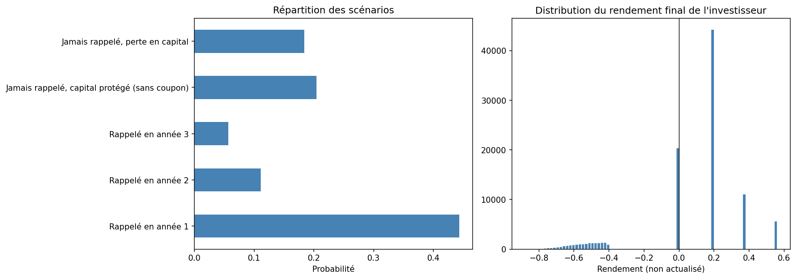

# Pricer d'Autocall en Monte Carlo

Pricing d'un produit structuré à barrières (autocall "Athena") par simulation Monte Carlo, avec calibration du coupon de marché et calcul des sensibilités (delta, vega) par différences finies. Sous-jacent : TotalEnergies.

## Le projet

Un autocall est un produit structuré vendu aux investisseurs par les banques : il verse un coupon conditionnel et peut se "rappeler" automatiquement si le sous-jacent est au-dessus d'une barrière à une date d'observation — sinon le capital est exposé à la baisse du sous-jacent à l'échéance. Contrairement à une option vanille, son prix dépend de **toute la trajectoire** du sous-jacent, pas seulement de son niveau final : il n'existe pas de formule fermée, il faut passer par la simulation Monte Carlo.

Plutôt que de se contenter de "pricer" le produit, ce projet reproduit la démarche d'un desk de structuring : partir du prix de vente voulu (100, le pair) et **calibrer le coupon** qui l'atteint — l'inverse du pricing académique classique, où le coupon est donné et on cherche le prix.

## Caractéristiques du produit modélisé

- Sous-jacent : action TotalEnergies (volatilité réelle de 28,6%, calculée dans le projet momentum)
- Maturité 3 ans, observation annuelle (3 dates)
- Barrière de rappel anticipé : 100% du niveau initial (+ coupon cumulé si atteinte)
- Barrière de protection du capital : 60% du niveau initial (perte proportionnelle en-dessous)

## Résultats clés

| | Valeur |
|---|---|
| Prix avec coupon à 8% (arbitraire) | 91,44 (pour 100 investis) |
| **Coupon juste (prix = 100)** | **18,75% par an** |
| Probabilité de rappel avec gain (an 1, 2 ou 3) | 61,2% |
| Probabilité de capital rendu sans coupon | 20,4% |
| Probabilité de perte en capital | 18,4% (perte moyenne : -54,4%) |
| Delta | 0,54 |
| Vega | -0,68 |

**Le coupon de marché calibré est de 18,75%** — un chiffre élevé qui s'explique par une barrière de rappel difficile à atteindre (100%) et une absence totale de filet en dessous de 60% : le produit doit offrir un coupon généreux pour compenser ce risque de queue.

**Le vega est négatif** (-0,68) : contrairement à une option vanille, plus de volatilité dégrade le prix de l'autocall, car le risque de passer sous la barrière de protection pèse plus lourd que l'avantage d'un rappel plus probable. Vendre un autocall, c'est vendre de la volatilité — une information clé pour expliquer le produit à un client ou structurer son prix de distribution.

## Fichiers

| Fichier | Description |
|---|---|
| `Pricer_Autocall_Monte_Carlo.ipynb` | Notebook Python complet (simulation, payoff, calibration du coupon, scénarios, Greeks) |
| `scenarios_autocall.png` | Répartition des scénarios et distribution du rendement final |
| `resultats_autocall.csv`, `scenarios_autocall.csv` | Résultats numériques exportés |

## Outils

Python (numpy, pandas, matplotlib), notebook Google Colab.

## Limites et pistes d'amélioration

- Volatilité constante (mouvement brownien géométrique) ; un pricing réel utilise une surface de volatilité (vol implicite variable selon strike/maturité)
- Observations annuelles seulement, alors que beaucoup d'autocalls réels observent trimestriellement
- Risque de crédit de l'émetteur non modélisé (un autocall est une dette de la banque qui l'émet)
- Barrière de rappel fixe à 100% ; les produits réels ont souvent une barrière dégressive, ce qui réduirait fortement le coupon nécessaire
- Taux et dividendes supposés constants sur toute la durée

---
*Projet réalisé dans le cadre d'une recherche de stage/alternance en finance de marché (structuring, sales, marketing de produits structurés).*
